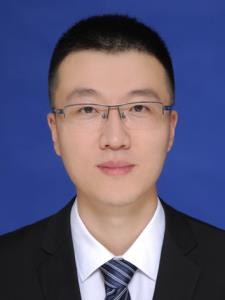
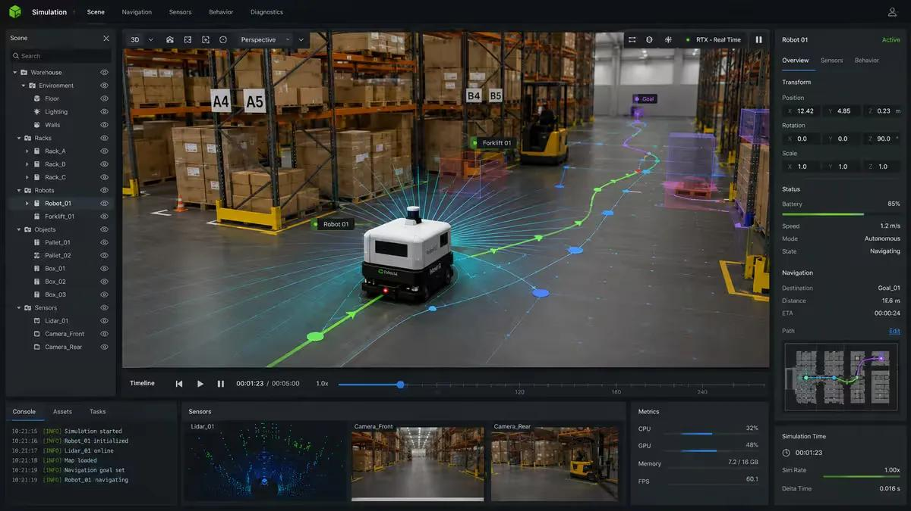

# 吕志超 博士后

## 概述
吕志超，男，博士后，1987年5月生，吉林省敦化市人。2023年获同济大学车辆工程博士学位。研究方向为智能驾驶类人决策方法研究，多目标物集群协同控制、高性能实车计算平台设计，航天飞行器姿态与惯导制导融合控制。

## 个人总结
复杂无人系统决策与控制研究者

长期从事复杂无人系统的建模、决策、控制及软件系统开发，研究方向涵盖动力学建模、智能决策、鲁棒控制、自主导航与多智能体协同。

具有车辆工程、控制科学与交通工程交叉研究背景，拥有从底层控制算法、动力学模型、嵌入式软件到系统集成的研发经验。曾参与动力总成控制系统开发、车辆电子控制系统研发、智能驾驶和车路云协同系统研究以及空天无人系统鲁棒控制等工程实践。

研究工作强调理论方法与工程应用的结合，关注复杂动态环境下无人系统的自主决策、运动规划与稳定控制，致力于建立从数学建模、算法设计、仿真验证到软件部署的完整技术链条。

目前重点关注多车协同决策与控制、拟人化智能决策、航天飞行器姿态与惯导制导融合控制、低空飞行器鲁棒控制，以及面向复杂无人系统的算法工程化与系统架构设计。

## 研究方向
01. 多车协同决策与控制
多智能体协同决策、博弈论、分布式控制、协同轨迹规划及复杂交通场景下的群体智能。

02. 拟人化智能决策
基于认知建模、博弈论、强化学习及行为预测的智能决策方法，研究自主系统在复杂交互环境中的行为生成机制。

03. 飞行器制导、导航与鲁棒控制
飞行动力学建模、惯性导航、制导与控制、鲁棒控制及复杂飞行环境下的自主飞行控制技术。

04. 无人系统算法工程化
面向无人车辆、移动机器人及飞行器的算法软件化、仿真平台开发、系统集成与工程部署。

## 个人技术理念
算法不应止步于数学表达，模型不应止步于仿真结果，技术最终需要进入真实系统并接受工程验证。
我更关注技术从理论到工程的完整过程：从问题抽象和数学建模开始，通过算法设计与仿真验证，最终形成可运行、可测试、可迭代的软件和控制系统。
